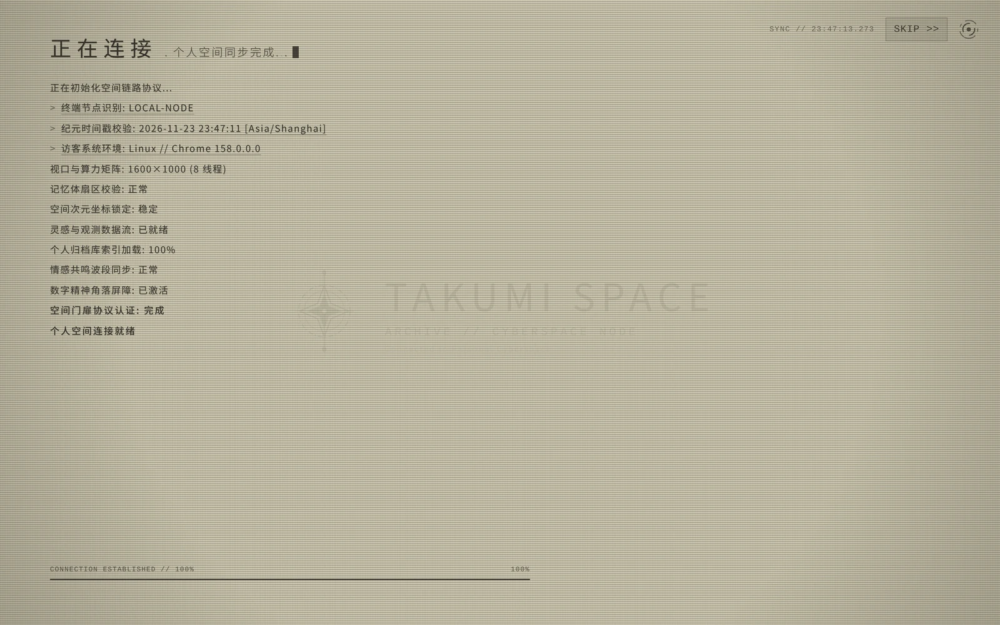
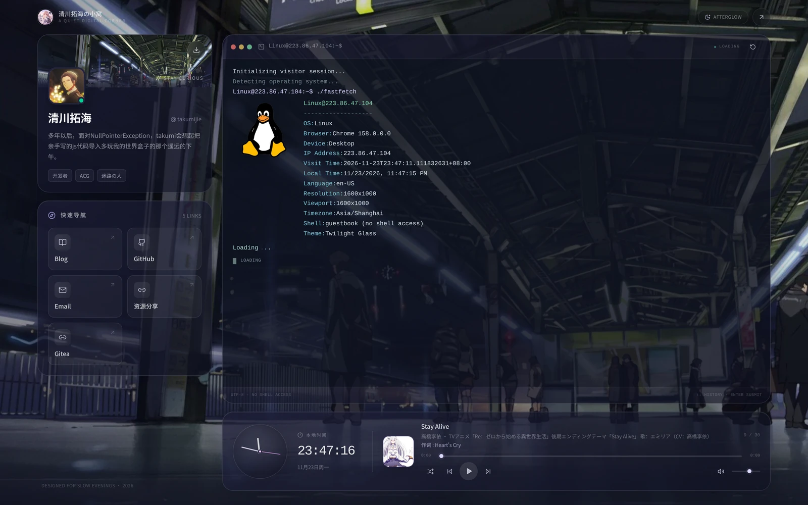
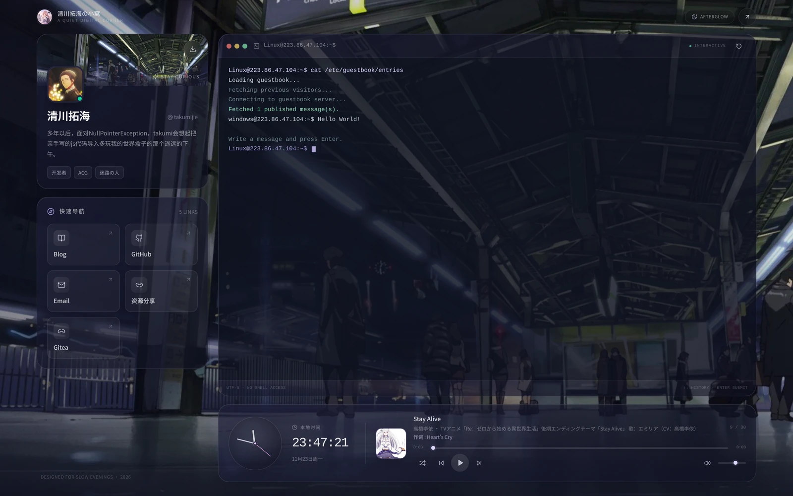

# Personal Index Navigation

一个可配置的个人主页与站点导航系统。前端采用 Vue 3，后端采用 Go + Gin，业务数据保存在 SQLite 中；前端构建产物嵌入 Go 程序，可作为单体服务部署。

项目包含个人资料、站点导航、设备展示、终端留言、日夜背景、时钟、多来源音乐播放和后台管理，适合部署为轻量个人数字空间。

## 界面预览

以下截图来自示例站点 [www.ilibilib.top](https://www.ilibilib.top)。

### 加载页

终端自检风格的启动页，完成后淡出进入主页。



### 主页终端 Fastfetch

访客进入后，终端会输出 Fastfetch 风格的系统与访客信息，随后进入留言交互。



### 加载完毕的主页

个人资料、快速导航、留言终端、时钟与音乐播放器全部就绪。



## 功能特性

- **个人资料**：配置头像、昵称、用户名、简介、标签和展示图片。
- **站点导航**：动态维护导航项目，支持图标、自定义图标地址、排序、显示开关和跳转方式。
- **设备展示**：管理电脑、手机、外设、操作系统和软件等内容，支持分类、排序与显隐。
- **动态背景**：按时间和时区切换日间/夜间背景，支持图片、视频直链和淡入淡出过渡。
- **加载页**：提供暗色与米白主题、音效开关、自定义水印文案和半调点阵徽章图片。
- **终端留言**：彩色 Fastfetch 风格访客信息、历史留言、模拟命令、留言审核、自动公开和长度限制；不会执行真实 Shell 命令。
- **时钟**：数字时钟与模拟时钟，支持 IANA 时区、12/24 小时制和自定义标签。
- **音乐播放器**：支持本地音乐、网易云音乐和 S3 兼容对象存储，提供播放/暂停、上下曲、进度、音量、随机/顺序/单曲循环、封面和逐句 LRC 歌词。
- **后台管理**：通过 `/admin` 管理站点内容、卡片显隐、留言、背景、播放列表、前台歌词和音乐来源。
- **持久化与响应式**：业务配置保存在 SQLite，上传文件保存在本地存储目录，页面适配桌面端和移动端。

## 技术栈

| 层级     | 技术                                                    |
| -------- | ------------------------------------------------------- |
| 前端     | Vue 3、TypeScript、Vite、Tailwind CSS、Lucide           |
| 后端     | Go 1.27、Gin、GORM、SQLite                              |
| 音乐来源 | 本地文件、NeteaseCloudMusicApiEnhanced、S3 兼容对象存储 |
| 部署     | 原生二进制、多阶段 Docker 构建、Distroless 非 root 运行 |

## Docker 部署（推荐）

项目根目录已提供 [Dockerfile](Dockerfile)。镜像构建会自动完成前端构建和 Go 静态编译，运行时不需要 Node.js、Go、Nginx 或独立数据库服务。

### 1. 构建镜像

```bash
docker build -t personal-index-navigation:latest .
```

### 2. 启动服务

以下命令使用 Docker 命名卷保存数据库和上传文件。请将示例密码替换为自己的强密码，管理员密码至少为 8 个 Unicode 字符，且 UTF-8 编码不超过 72 字节。

```bash
docker volume create homepage-data
docker volume create homepage-storage

docker run -d \
  --name personal-homepage \
  --restart unless-stopped \
  -p 8080:8080 \
  -e HOMEPAGE_ADMIN_PASSWORD='replace-with-a-strong-password' \
  -e HOMEPAGE_SERVER_COOKIE_SECURE=false \
  -e HOMEPAGE_MEDIA_ALLOW_INSECURE_HTTP=true \
  -v homepage-data:/data \
  -v homepage-storage:/storage \
  personal-index-navigation:latest
```

启动后访问：

- 主页：`http://localhost:8080/`
- 管理后台：`http://localhost:8080/admin`
- 健康检查：`http://localhost:8080/healthz`

默认管理员用户名为 `admin`，首次初始化密码为 `HOMEPAGE_ADMIN_PASSWORD` 的值；已有管理员普通重启时可移除该变量，启动配置不会覆盖已有用户名或密码。镜像默认使用 `release` 模式并监听 `0.0.0.0`，所有模式都禁止使用 `admin123`。上面的 `cookie_secure=false` 仅用于直接 HTTP 本地验证；经 Nginx 等反向代理提供 HTTPS 时，应删除该变量或显式设为 `true`，并按实际代理地址配置 `server.trusted_proxies`。

### 3. 检查运行状态

```bash
docker ps
docker logs -f personal-homepage
curl --fail http://localhost:8080/healthz
```

### 4. 使用自定义配置文件

容器不挂载配置时使用内置路径 `/data/homepage.db` 和 `/storage`。如需修改监听端口、可信代理或上传限制，可复制 `config.yaml` 为 `config.prod.yaml`，修改后挂载：

```bash
docker run -d \
  --name personal-homepage \
  --restart unless-stopped \
  -p 8080:8080 \
  -e HOMEPAGE_CONFIG=/config.yaml \
  -e HOMEPAGE_ADMIN_PASSWORD='replace-with-a-strong-password' \
  -e HOMEPAGE_SERVER_COOKIE_SECURE=true \
  -v "$PWD/config.prod.yaml:/config.yaml:ro" \
  -v homepage-data:/data \
  -v homepage-storage:/storage \
  personal-index-navigation:latest
```

上述 `cookie_secure=true` 示例面向由 Nginx 等反向代理提供 HTTPS 的生产环境，不能用于通过非 localhost 的普通 HTTP 地址登录。仅本机 HTTP 调试时，将该变量改为 `HOMEPAGE_SERVER_COOKIE_SECURE=false`，并通过 `http://localhost:8080/admin` 登录；健康检查仍可访问 `http://localhost:8080/healthz`，无需 Cookie。

自定义配置的 `server.port` 需要与端口映射对应。例如配置为 `8081`，则使用 `-p 8080:8081`。

> 容器以 UID/GID `65532` 的非 root 用户运行。推荐使用上述命名卷；如果改用宿主机目录绑定挂载，需要确保该用户对目录具有读写权限。

## 原生二进制部署（无 Docker）

不安装 Docker 也可以部署。前端静态资源会嵌入 Go 二进制，运行时不需要 Node.js、Go、Nginx 或独立数据库服务；Go 和 Node.js 仅在构建阶段需要。

以下命令适用于目标 Linux 服务器，或与目标服务器具有相同操作系统和架构的构建环境。

### 1. 构建前端和二进制

```bash
npm ci --prefix frontend
npm run build --prefix frontend
mkdir -p web/dist
cp -r frontend/dist/* web/dist/
CGO_ENABLED=0 go build -trimpath -ldflags="-s -w" -o homepage ./cmd/server
```

### 2. 准备生产配置

```bash
cp config.yaml config.prod.yaml
mkdir -p data storage
```

按需修改 `config.prod.yaml` 中的监听地址、端口、可信代理和上传限制。仓库示例端口为 `8081`，数据库和文件分别保存在 `data/homepage.db` 与 `storage/`。

### 3. 启动服务

以下示例面向由 Nginx 等反向代理提供 HTTPS 的生产环境：

```bash
HOMEPAGE_CONFIG=config.prod.yaml \
HOMEPAGE_SERVER_MODE=release \
HOMEPAGE_SERVER_COOKIE_SECURE=true \
HOMEPAGE_ADMIN_PASSWORD='replace-with-a-strong-password' \
./homepage
```

按实际配置端口访问主页和 `/admin`。`cookie_secure=true` 不适用于非 localhost 的普通 HTTP 登录；仅本机 HTTP 调试时，将其改为 `HOMEPAGE_SERVER_COOKIE_SECURE=false` 并通过 localhost 访问。健康检查使用 HTTP 且不依赖 Cookie，使用仓库示例端口时：

```bash
curl --fail http://localhost:8081/healthz
```

生产环境可使用 systemd、Supervisor 或 Windows 服务管理器托管二进制。托管时需要保留上述环境变量，将服务的工作目录指向配置文件所在目录，并确保运行用户对数据库和存储目录具有读写权限。

构建完成后，部署到同架构服务器时只需复制二进制和生产配置；`data/`、`storage/` 应在服务器上创建并持久化。前端已经嵌入二进制，无需另外部署静态网站。

## 配置说明

配置分为两类：

1. **启动配置**：监听地址、数据库路径、管理员账号等，来自 YAML 和少量环境变量。
2. **站点业务配置**：背景、资料、导航、留言和音乐等，通过后台修改并保存到 SQLite，不会写回 `config.yaml`。

### 启动配置文件

默认读取程序工作目录下的 `config.yaml`，可通过 `HOMEPAGE_CONFIG` 指定其他路径。本地开发示例：

```yaml
server:
  listen: "127.0.0.1"
  port: 8081
  mode: debug
  trusted_proxies: []
  cookie_secure: false

database:
  path: data/homepage.db

storage:
  path: storage

admin:
  username: admin
  password: ""

upload:
  max_image_bytes: 10485760
  max_music_bytes: 52428800

media:
  allow_insecure_http: false
```

| 配置项                     | 说明                                                                  |
| -------------------------- | --------------------------------------------------------------------- |
| `server.listen`          | HTTP 监听地址，内置默认 `127.0.0.1`；Docker 显式覆盖为 `0.0.0.0`。 |
| `server.port`            | HTTP 端口。仓库配置为 `8081`；Docker 未挂载配置时为 `8080`。      |
| `server.mode`            | 支持 `debug`、`release`、`test`，内置默认 `release`。          |
| `server.trusted_proxies` | 可信反向代理 IP 或 CIDR 列表。只有可信代理的转发头才用于解析访客 IP。 |
| `server.cookie_secure`   | 会话 Cookie 的 Secure 属性；release 默认 true，debug/test 默认 false。 |
| `database.path`          | SQLite 数据库文件路径。                                               |
| `storage.path`           | 图片、音乐、歌词和封面缓存等文件的存储根目录。                        |
| `admin.username`         | 管理员用户名，默认为 `admin`。                                      |
| `admin.password`         | 首次初始化或密码重置使用的管理员密码，至少 8 个 Unicode 字符且 UTF-8 不超过 72 字节；推荐使用环境变量提供。 |
| `upload.max_image_bytes` | 单张图片上传大小上限，默认 10 MiB。                                   |
| `upload.max_music_bytes` | 单个音乐文件上传大小上限，默认 50 MiB。                               |
| `media.allow_insecure_http` | 是否允许向浏览器返回 HTTP 音频和封面地址，默认 false；仅限受控 HTTP 部署开启。 |

空库首次启动必须提供合法初始密码；已有管理员后，普通启动不再要求密码，也不会根据启动配置覆盖已有用户名或密码。需要重置时先停止服务，复用同一配置文件或环境变量提供新密码：

```bash
HOMEPAGE_ADMIN_PASSWORD='replace-with-a-new-strong-password' ./homepage --reset-admin-password
```

该命令完成数据库迁移后更新管理员哈希、删除所有既有会话并退出，不启动 HTTP 服务。新密码缺失或不合法时不会修改管理员或会话数据。

需要复核曲目本地资源时，先停止服务并备份数据库与 `storage/`，再执行：

```bash
./homepage --audit-track-resources
```

该命令复用当前配置，完成数据库迁移后扫描 `storage/music`、`storage/lyrics`、`storage/covers`，向标准输出写入 JSON 报告并退出，不启动 HTTP 服务。报告分类列出孤儿、共享引用、不符合命名规则及非普通文件；它不会删除或修复任何历史文件，也不会执行站点数据初始化。

SQLite 使用 WAL 模式，数据库、`-wal` 和 `-shm` 文件应按 0600 权限保护，备份文件也应采用相同的访问控制。运行中备份请使用 SQLite 在线备份 API 或 `VACUUM INTO`，不要只复制正在写入的单个 DB 文件而遗漏 WAL 内容。

### 环境变量

配置加载顺序为：内置默认值 → YAML → 下列环境变量。

| 环境变量                    | 用途                                                        |
| --------------------------- | ----------------------------------------------------------- |
| `HOMEPAGE_CONFIG`         | YAML 配置文件路径，默认 `config.yaml`。                   |
| `HOMEPAGE_SERVER_MODE`    | 覆盖 `server.mode`；Docker 镜像默认设为 `release`。     |
| `HOMEPAGE_SERVER_LISTEN`  | 覆盖 `server.listen`；Docker 镜像默认设为 `0.0.0.0`。 |
| `HOMEPAGE_SERVER_PORT`    | 覆盖 `server.port`，范围为 1～65535。                    |
| `HOMEPAGE_TRUSTED_PROXIES` | 覆盖可信代理列表，多个 IP/CIDR 以逗号分隔。              |
| `HOMEPAGE_SERVER_COOKIE_SECURE` | 显式覆盖 Cookie Secure；仅受控 HTTP 调试可设为 false。 |
| `HOMEPAGE_DATABASE_PATH`  | 覆盖数据库路径；Docker 镜像默认设为 `/data/homepage.db`。 |
| `HOMEPAGE_STORAGE_PATH`   | 覆盖存储路径；Docker 镜像默认设为 `/storage`。            |
| `HOMEPAGE_ADMIN_USERNAME` | 覆盖 `admin.username`，仅用于空库首次初始化。            |
| `HOMEPAGE_ADMIN_PASSWORD` | 覆盖初始化或重置密码，已有管理员普通重启时可移除。        |
| `HOMEPAGE_UPLOAD_MAX_IMAGE_BYTES` | 覆盖图片上传字节数上限。                          |
| `HOMEPAGE_UPLOAD_MAX_MUSIC_BYTES` | 覆盖音乐上传字节数上限。                          |
| `HOMEPAGE_MEDIA_ALLOW_INSECURE_HTTP` | 显式允许 HTTP 浏览器媒体，仅支持 true 或 false。 |

显式设置 `HOMEPAGE_CONFIG` 后，文件缺失、不可读、包含未知字段或解析失败都会阻止启动，不会静默回退到默认配置。可将 `config.yaml` 复制为已忽略的 `config.local.yaml` 保存本地私有配置。

直接 HTTP 本地运行使用 `cookie_secure: false`；生产环境应由 Nginx 等反代提供 HTTPS，并保持 release 默认的 Secure Cookie。服务不会根据客户端提交的 `X-Forwarded-Proto` 自动改变该安全属性。

release 模式默认拒绝向公开播放和封面接口返回 HTTP 媒体地址，避免 HTTPS 页面发生浏览器混合内容拦截；不会把任意 HTTP URL 自动改写为可能不可用的 HTTPS。debug/test 模式保留本机 HTTP 开发兼容。确需在受控 HTTP 环境部署时，同时设置 `HOMEPAGE_SERVER_COOKIE_SECURE=false` 和 `HOMEPAGE_MEDIA_ALLOW_INSECURE_HTTP=true`，不要将兼容开关用于 HTTPS 生产环境。

### 后台业务配置

登录 `/admin` 后可以维护：

- 个人资料、导航项目和设备信息。
- 站点标题、时钟时区与时间格式。
- 日间/夜间图片或视频背景、切换时间、调度时区和过渡时长。
- 各主页卡片的显示状态。
- 加载页主题、音效、水印和徽章。
- Fastfetch 停留时长、留言最大长度和自动公开策略。
- 本地音乐、网易云音乐、S3 兼容对象存储及播放列表。
- 前台固定播放列表和逐句歌词开关。

## 网易云音乐 API 配置

**本项目仅对 [NeteaseCloudMusicApiEnhanced](https://github.com/neteasecloudmusicapienhanced/api-enhanced) 的接口做了适配，不保证其他网易云 API 实现的兼容性。**

项目不会内置公共或私人 API 地址，也不会自动部署该上游服务。使用网易云来源前，需要：

1. 按上游项目说明自行部署 NeteaseCloudMusicApiEnhanced。
2. 确认主页服务所在容器或主机可以访问该 API 服务。
3. 登录主页后台，进入“音乐管理 → 网易云音乐”。
4. 在“网易云 API 配置”中填写服务根地址，例如 `https://netease-api.example.com`，然后保存。
5. 使用二维码登录网易云账号。
6. 通过歌曲搜索或歌单导入创建播放列表，也可将搜索结果追加到已有列表。
7. 在“播放列表”中设置前台播放列表和歌词开关。

API 地址应填写根地址，不要在末尾拼接 `/search`、`/song/url/v1` 等具体接口。当前适配的接口包括：

```text
/login/qr/key
/login/qr/create
/login/qr/check
/login/status
/logout
/search
/playlist/detail
/playlist/track/all
/song/detail
/song/url/v1
/lyric
```

登录 Cookie 会保存在主页的 SQLite 数据库中，不会通过公开 API 返回。修改 API 根地址会清除已保存的网易云 Cookie，需要重新登录。

> 如果 API 与主页都通过容器部署，不要在主页容器中用 `localhost` 指向另一容器。请使用同一 Docker 网络中的服务名、可访问的宿主机地址或域名。歌曲能否播放仍取决于上游服务、账号权限、版权和地区限制。

## S3 兼容对象存储

在“音乐管理 → 对象存储”中配置 Endpoint、Region、Bucket、Access Key、Secret、对象前缀、Path Style 和访问模式。支持使用公开地址或预签名地址播放，可直接从对象列表创建或追加播放列表。

Secret 等敏感配置保存在 SQLite 中。请保护数据库备份，并遵循最小权限原则配置对象存储凭据。普通保存时 Secret 留空表示保留原值；需要撤销已保存凭据时，使用“清除已保存 Secret”并确认。清除后配置处于不完整状态，S3 播放、列举和连接测试会明确失败，直到重新填写并保存 Secret；读取接口不会返回 Secret。

## 本地开发

环境要求：

- Go 1.27+
- Node.js 24+
- npm

仓库中的 `config.yaml` 默认监听 `8081`，前端 Vite 开发服务器已将 `/api` 代理到该端口。

### 启动后端

仓库只跟踪 `web/dist/index.html` 占位入口。启动完整站点前，请先完成下方“构建前端并运行完整站点”中的依赖安装、前端构建和资源同步；仅运行 Go 单元测试不需要这些步骤。

```powershell
$env:HOMEPAGE_ADMIN_PASSWORD='replace-with-a-local-strong-password'
go run ./cmd/server
```

### 启动前端开发服务器

```powershell
npm ci --prefix frontend
npm run dev --prefix frontend
```

访问 Vite 输出的地址，通常为 `http://localhost:5173`。

### 构建前端并运行完整站点

Go 实际嵌入的是 `web/dist`，不是 `frontend/dist`。修改前端后，需要构建、同步静态资源并重启 Go 服务：

```powershell
npm ci --prefix frontend
npm run build --prefix frontend
New-Item -ItemType Directory -Force -Path "web\dist" | Out-Null
Copy-Item -Path "frontend\dist\*" -Destination "web\dist" -Recurse -Force
go run ./cmd/server
```

然后访问 `http://localhost:8081`，后台为 `http://localhost:8081/admin`。

## 测试与构建检查

`web/dist` 只跟踪最小的 `index.html` 占位入口，真实 JS、CSS 和 hash bundle 等构建产物仍被 `.gitignore` 和 `.dockerignore` 忽略。Go 路由测试使用独立的内存静态资源夹具，因此干净克隆无需安装 Node.js 或构建前端即可执行：

```powershell
go test ./...
go vet ./...
```

运行或部署完整站点仍须先构建前端并同步真实产物到 `web/dist`；Docker 多阶段构建会自动完成这些步骤。本地前端测试、构建和同步命令如下：

```powershell
npm ci --prefix frontend
npm run test --prefix frontend
npm run build --prefix frontend
New-Item -ItemType Directory -Force -Path "web\dist" | Out-Null
Copy-Item -Path "frontend\dist\*" -Destination "web\dist" -Recurse -Force
```

## 数据持久化与备份

| 数据               | 本地默认路径         | Docker 默认路径       |
| ------------------ | -------------------- | --------------------- |
| SQLite 数据库      | `data/homepage.db` | `/data/homepage.db` |
| 上传文件与封面缓存 | `storage/`         | `/storage/`         |

数据库包含站点配置、留言、曲目、播放列表、管理员密码哈希以及音乐 Provider 配置。备份时应同时保存数据库和整个存储目录；建议先停止服务再复制 SQLite 数据，避免复制到不一致的数据库或 WAL 状态。

升级时重新构建镜像并替换容器即可，但必须保留并重新挂载原来的 `/data` 和 `/storage` 卷。

## 反向代理与生产环境建议

- 使用 HTTPS，并设置强管理员密码。
- 在 `server.trusted_proxies` 中只填写实际反向代理的 IP 或 CIDR，不要无条件信任所有代理。
- 反向代理需要传递客户端 IP 转发头，否则终端和留言无法显示真实访客 IP。
- 上传限制需要与反向代理的请求体大小限制保持一致。
- 网易云 API 和 S3 凭据应妥善保护；网易云 API 可仅对主页服务所在的内部网络开放。
- 如果 Nginx 在网易云扫码登录成功时返回 502，请检查并适当增大代理响应头缓冲区。

## 项目结构

```text
.
├── cmd/server/          # Go 服务入口与健康检查
├── internal/            # 配置、路由、业务服务、仓储和中间件
├── migrations/          # 数据库迁移
├── frontend/            # Vue 3 前端源码
├── web/dist/            # 嵌入 Go 程序的前端构建产物
├── data/                # 本地 SQLite 数据
├── storage/             # 上传文件与封面缓存
├── assets/screenshots/  # README 展示截图
├── config.yaml          # 本地启动配置
└── Dockerfile           # 多阶段生产镜像构建
```

## 许可证

本项目采用 [GNU General Public License v3.0（GPL-3.0）](LICENSE)。使用第三方音乐、图片、Logo 和 API 时，还需遵守对应服务的条款与授权要求。
